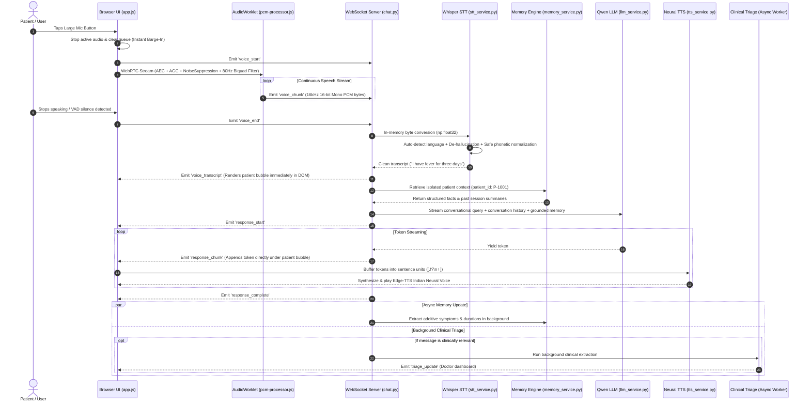

# MediKiosk AI: Full End-to-End System Workflow Specification

**Version**: 2.0.0  
**Project**: MediKiosk AI Conversational Medical Kiosk & Triage Assistant  
**Repository Path**: `c:\Users\Harish\Desktop\MEDIKIOSK\Medikiosk`  
**Last Updated**: September 2026  

---

## 1. Executive Summary & Core Philosophy

**MediKiosk AI** is a real-time, multilingual, voice-first conversational AI assistant with integrated asynchronous clinical triage support. It is built specifically for kiosk deployments and older adults.

### Key Architectural Principles:
1. **Direct Voice-to-Text Pipeline**: Microphones capture audio via browser WebRTC, apply hardware echo cancellation, noise suppression, auto gain control, and an 80Hz acoustic high-pass filter. Audio is streamed over WebSockets as 16kHz PCM to an in-memory Whisper STT engine with zero disk I/O.
2. **Safe Speech Normalization (Zero Hallucination)**: Phonetic normalization corrects colloquial slips (e.g. *"2 days ah"* $\rightarrow$ *"2 days-ஆ"*) without ever inventing medical symptoms the patient did not state.
3. **Decoupled 3-Layer Multilingual Engine**: STT language, conversation/LLM language, and TTS language are independently detected across 11 Indian and global languages with native support for mixed code-switching (Tanglish, Hinglish, Telugish, Marathish, Gujaratish).
4. **Strictly Isolated 3-Tier Patient Memory**: Patient records (`P-1001` vs `P-1002`) are strictly partitioned. Memory stores short-term session turns, cross-session summaries, and additive structured medical facts, grounding recall queries (*"What did I tell you earlier?"*).
5. **Real-Time Token Streaming with Sentence-Level Neural TTS**: Qwen 2.5 streams tokens directly to the client UI over WebSockets while an asynchronous sentence buffer synthesizes Indian Neural voices with instant barge-in cancellation.
6. **Non-Blocking Background Clinical Extraction**: General queries bypass medical extraction entirely; medical messages trigger a background worker that extracts structured triage facts into the doctor dashboard without stalling the chat stream.

---

## 2. High-Level Architecture Flowchart

```text
 ┌────────────────────────────────────────────────────────────────────────────────────────┐
 │                                   CLIENT / FRONTEND                                    │
 │                                                                                        │
 │   ┌──────────────────────┐                     ┌───────────────────────────────────┐   │
 │   │     TEXT INPUT       │                     │         VOICE INPUT (WebRTC)      │   │
 │   │  Typed by user/kiosk │                     │  16kHz Mono PCM + 80Hz HPF + VAD  │   │
 │   └──────────┬───────────┘                     └─────────────────┬─────────────────┘   │
 └──────────────┼───────────────────────────────────────────────────┼─────────────────────┘
                │ chat_message                                      │ voice_chunk
                ▼                                                   ▼
 ┌────────────────────────────────────────────────────────────────────────────────────────┐
 │                             BACKEND WEBSOCKET SERVER (Flask)                           │
 │                                                                                        │
 │                           ┌──────────────────────────────┐                             │
 │                           │ In-Memory Multilingual STT   │                             │
 │                           │ (Whisper + De-hallucination) │                             │
 │                           └──────────────┬───────────────┘                             │
 │                                          │ Clean Text                                  │
 │                                          ▼                                             │
 │                         ┌──────────────────────────────────┐                           │
 │                         │ 3-Tier Isolated Patient Memory   │                           │
 │                         │ (P-1001 vs P-1002 Isolation)     │                           │
 │                         └────────────────┬─────────────────┘                           │
 │                                          │ Grounded Context + History                  │
 │                                          ▼                                             │
 │                         ┌──────────────────────────────────┐                           │
 │                         │  Qwen 2.5 Streaming LLM Engine   │                           │
 │                         │  (Zero Questionnaire Gate)       │                           │
 │                         └───────┬──────────────────┬───────┘                           │
 │                                 │                  │                                   │
 │       Streaming Tokens (WS)     │                  │ Medical Messages Only (Async)     │
 │                                 ▼                  ▼                                   │
 │                ┌──────────────────────┐  ┌───────────────────────────────────┐         │
 │                │  Sentence Neural TTS │  │ Background Clinical Extraction    │         │
 │                │  (Edge-TTS IN Voices)│  │ (Doctor Triage Dashboard Summary) │         │
 │                └──────────────────────┘  └───────────────────────────────────┘         │
 └────────────────────────────────────────────────────────────────────────────────────────┘
```

---

## 3. Sequence Diagram (End-to-End Interaction)



---

## 4. Layer-by-Layer Detailed Technical Breakdown

### Layer 1: Frontend Audio Capture & Acoustic Preprocessing
- **Source Files**: 
  - `app/static/js/audio_recorder.js`
  - `app/static/js/pcm-processor.js`
  - `app/static/js/app.js`
- **Responsibilities**:
  1. **Hardware Constraints**: Queries `navigator.mediaDevices.getUserMedia` with:
     ```javascript
     {
       audio: {
         channelCount: 1,
         sampleRate: 16000,
         echoCancellation: true,
         noiseSuppression: true,
         autoGainControl: true
       }
     }
     ```
  2. **80Hz High-Pass Acoustic Filter**: A `BiquadFilterNode` (`type = 'highpass'`, `frequency = 80Hz`) strips motor hum, fan rumble, and table vibration before audio reaches the VAD analyzer or STT.
  3. **Real-Time AudioWorklet**: `pcm-processor.js` runs on a dedicated audio rendering thread, downsampling input samples and packaging them as 16kHz 16-bit Mono PCM chunks.
  4. **Dynamic Voice State Machine**: Transitions across 8 visual states (`IDLE`, `LISTENING`, `SPEAKING_DETECTED`, `TRANSCRIBING`, `SENDING`, `AI_RESPONDING`, `ERROR`, `OFFLINE`).
  5. **Mobile Permission & HTTPS Diagnostics**: Checks `window.isSecureContext` and `navigator.mediaDevices`. Opens `#micPermissionModal` with step-by-step unblock instructions for Android Chrome and iOS Safari if permissions are denied.

---

### Layer 2: In-Memory Multilingual STT & Normalization
- **Source Files**:
  - `app/services/stt_service.py`
  - `app/routes/chat.py`
- **Responsibilities**:
  1. **Zero Disk I/O**: Accumulates PCM chunks in memory per client session and normalizes directly into a NumPy `float32` array:
     ```python
     audio_data = np.frombuffer(pcm_bytes, dtype=np.int16).astype(np.float32) / 32768.0
     ```
  2. **Multilingual Auto-Detection**: Whisper runs with `language=None`, detecting English, Tamil, Hindi, Telugu, Malayalam, Kannada, Bengali, Marathi, Gujarati, Punjabi, and Urdu.
  3. **De-Hallucination Filter**: Strips phantom Whisper artifacts (`"Thank you for watching"`, `"Please subscribe"`) and collapses stammering word loops (`"fever fever fever"` $\rightarrow$ `"fever"`).
  4. **Safe Speech Normalizer**: Converts colloquial phonetics without ever guessing or hallucinating unmentioned medical facts:
     - *"2 days ah"* $\rightarrow$ *"2 days-ஆ"*
     - *"enaku fever iruku"* $\rightarrow$ *"enakku fever irukku"*
     - *"I have pain"* $\rightarrow$ *"I have pain"* (Never turns into *"severe chest pain"*).

---

### Layer 3: Isolated 3-Tier Patient Memory
- **Source Files**:
  - `app/services/memory_service.py`
- **Responsibilities**:
  1. **Strict User Isolation**: All memory is strictly keyed by `patient_id`. User A (`P-1001`) data is completely segregated from User B (`P-1002`).
  2. **3 Memory Tiers**:
     - **Level 1 (Short-Term)**: Active session conversation turns.
     - **Level 2 (Session Summaries)**: Cross-session summaries for persistent recall.
     - **Level 3 (Structured Medical Facts)**: Additive symptom and duration tracking across turns:
       ```json
       {
         "patient_id": "P-1001",
         "languages": ["ta", "en"],
         "preferred_language": "ta",
         "recent_language": "en",
         "medical_memory": [
           { "fact": "fever", "duration": "for 3 days", "source": "user" },
           { "fact": "chest pain", "duration": null, "source": "user" }
         ]
       }
       ```
  3. **Recall Grounding**: When a patient asks *"What did I tell you earlier?"* or *"How long have I had fever?"*, structured facts are formatted and grounded directly inside the prompt context.
  4. **Multi-Turn Language Persistence**: Remembers all languages spoken by the patient without resetting conversation state or clinical context.

---

### Layer 4: Qwen 2.5 LLM Streaming Engine
- **Source Files**:
  - `app/services/llm_service.py`
  - `app/routes/chat.py`
- **Responsibilities**:
  1. **Zero Hardcoded Questionnaires**: General topics (programming, casual chat, greetings) are handled naturally without forcing medical templates.
  2. **Real-Time Token Streaming**: Streams tokens over WebSocket `response_chunk`, rendering the AI response bubble directly beneath the patient's bubble.
  3. **Emoji Stripping**: Removes emojis (`🤖`, `🎤`, `🩺`, `😊`) to ensure high contrast, accessible UI rendering.
  4. **Emergency Red-Flag Detection**: If severe symptoms (severe chest pain, difficulty breathing, sudden numbness) appear, communicates urgency and advises emergency medical assistance.

---

### Layer 5: Sentence-Level Streaming Neural TTS & Instant Barge-In
- **Source Files**:
  - `app/services/tts_service.py`
  - `app/static/js/app.js`
- **Responsibilities**:
  1. **Sentence Boundary Buffering**: Buffers incoming LLM tokens into sentence units (`[.!?\n।]`) and synthesizes each sentence immediately.
  2. **Script-Driven Indian Neural Voice Selection**:
     - **English**: `en-IN-NeerjaNeural`
     - **Tamil**: `ta-IN-PallaviNeural`
     - **Hindi**: `hi-IN-SwaraNeural`
     - **Telugu**: `te-IN-ShrutiNeural`
     - **Kannada**: `kn-IN-SapnaNeural`
     - **Malayalam**: `ml-IN-SobhanaNeural`
     - **Bengali**: `bn-IN-TanishaaNeural`
     - **Marathi**: `mr-IN-AarohiNeural`
     - **Gujarati**: `gu-IN-DhwaniNeural`
     - **Punjabi**: `pa-IN-OjasNeural`
     - **Urdu**: `ur-IN-SalmanNeural`
  3. **Instant Barge-In**: When the patient speaks or taps the microphone, active TTS playback stops immediately, the sentence queue is flushed, and the microphone begins capturing.

---

### Layer 6: Asynchronous Clinical Triage & Doctor Dashboard
- **Source Files**:
  - `app/routes/chat.py`
  - `app/services/database_service.py`
- **Responsibilities**:
  1. **Relevance Gating**: Evaluates whether the turn contains medical keywords across English, Tamil, Hindi, Telugu, Kannada, Malayalam, Bengali, Marathi, Gujarati, Punjabi, or Urdu.
  2. **Asynchronous Fact Extraction**: If medical, extracts structured attributes (`chief_complaint`, `onset`, `severity`, `urgency_level`, `associated_symptoms`) in a background daemon thread.
  3. **Live Dashboard Update**: Emits `triage_update` over WebSockets to update the right-hand triage panel in real time without blocking the conversational stream.

---

## 5. WebSocket Event Protocol Reference

| Event Name | Direction | Payload Structure | Description |
| :--- | :--- | :--- | :--- |
| `voice_start` | Client $\rightarrow$ Server | `{}` | Initializes in-memory PCM buffer for client SID |
| `voice_chunk` | Client $\rightarrow$ Server | `Binary PCM / {"pcm": ...}` | 16kHz 16-bit Mono PCM byte chunk |
| `voice_end` | Client $\rightarrow$ Server | `{"session_id": "...", "patient_id": "...", "language": "auto"}` | Ends audio stream and triggers in-memory transcription |
| `voice_transcript` | Server $\rightarrow$ Client | `{"status": "success", "text": "...", "language": "...", "confidence": 0.95}` | Clean STT transcript emitted to UI |
| `chat_message` | Client $\rightarrow$ Server | `{"message": "...", "session_id": "...", "patient_id": "...", "language": "..."}` | Dispatches verified user text to Qwen LLM |
| `response_start` | Server $\rightarrow$ Client | `{"session_id": "...", "patient_id": "..."}` | Notifies client that AI token generation has begun |
| `response_chunk` | Server $\rightarrow$ Client | `{"token": "...", "session_id": "...", "patient_id": "..."}` | Individual streaming token |
| `response_complete` | Server $\rightarrow$ Client | `{"full_text": "...", "session_id": "...", "telemetry": {...}}` | Final AI message with latency metrics |
| `triage_update` | Server $\rightarrow$ Client | `{"session_id": "...", "triage": {...}}` | Asynchronous structured clinical triage update |

---

## 6. Verification Test Suite

Run the full automated verification test suite:

```bash
python scripts/verify_all.py
```

### Verification Coverage:
1. **Clinical Relevance Gate**: Non-medical questions bypass extraction; medical queries trigger extraction.
2. **11-Language Multilingual Detection**: Native scripts and mixed Tanglish/Hinglish/Telugish/Marathish/Gujaratish.
3. **Patient Memory Accumulation**: Additive symptoms and duration tracking without overwriting.
4. **Strict Patient Isolation**: `P-1001` vs `P-1002` zero cross-user memory leakage.
5. **Prompt Context Builder**: Grounded memory injection for accurate recall queries.
6. **Multi-Session Cross-Recall**: Persistent summaries across multiple sessions.
7. **STT De-Hallucination**: Phantom subtitle filtering and safe phonetic speech normalization.
8. **Response-Driven TTS Selection**: Neural Indian voice matching and markdown stripping.
9. **Patient Multi-Language History Tracking**: Multi-lingual turn tracking in memory without context reset.
10. **Live LLM Health Probe**: Real-time Qwen server latency and availability checking.

---

## 7. Developer Quickstart & Run Instructions

### 1. Start Qwen Compliance Server
```bash
cd c:\Users\Harish\Desktop\MEDIKIOSK\qwen-compliance-api-main\qwen-compliance-api-main
python -m uvicorn app.main:app --host 0.0.0.0 --port 8000
```

### 2. Start MediKiosk Flask Application
```bash
cd c:\Users\Harish\Desktop\MEDIKIOSK\Medikiosk
python run.py
```

### 3. Open Browser
- **URL**: `http://127.0.0.1:5000`
- **Mobile Access**: Use an HTTPS reverse proxy (e.g. Cloudflare Tunnel or ngrok) to enable WebRTC microphone access on mobile browsers.
